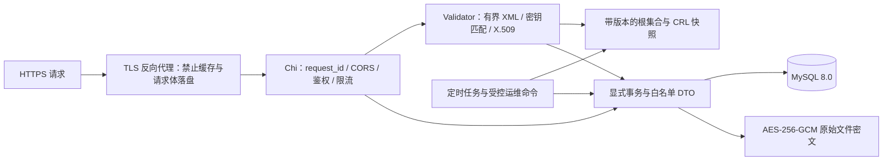

# Keybox 后端设计与运维

本仓库提供可编译、可运行、带真实 MySQL 集成测试的后端，以及查询与管理 Web UI。API 的完整字段、
状态码和错误码以 `api/openapi.json` 与 `docs/api.md` 为契约。

`valid` 表示本次校验时：XML/密钥匹配、证书路径、信任根、有效期、可用的 Google 吊销
状态均通过。它不代表私钥仍保密、不证明当前设备的硬件身份，也不承诺通过任何第三方
完整性检查。Keybox 一旦允许匿名下载，其私钥就可以被复制，关闭下载无法撤回已有副本。

## 1. 架构与目录

选择模块化单体：Chi 基于 `net/http`，没有额外上下文生命周期，便于 `httptest`、
超时传递和中间件组合；GORM 只用于显式查询与事务，不使用 AutoMigrate；
golang-migrate 管理版本化 SQL。MySQL 8.0 InnoDB 同时承担持久化、跨实例配额和并发租约。
暂不引入 Redis、消息队列或公开对象存储。

Go 模块最低版本为 1.26，Docker 构建固定 1.27.3，满足 Go 1.22+ 的技术范围。
选择较新的最低版本是为了使用已修补的 `x/text`、`x/crypto` 等依赖。



```text
cmd/keybox/                 serve / migrate-up / init-admin / 运维命令
internal/config/            环境变量与 *_FILE 敏感配置
internal/domain/            状态、公开校验结果、下载规则
internal/validator/         有界解析、逐链与逐证书校验；可注入依赖
internal/trust/             CRL 缓存、HTTP 客户端、受控根集合及内置公共根
internal/security/          AES-GCM、随机 token、SHA-256、HMAC
internal/store/             GORM 模型、事务、配额、并发租约
internal/httpapi/           路由、DTO、认证、CSRF、公开/管理/下载接口
internal/jobs/              CRL 刷新、再校验、根更新检测、清理
internal/testutil/          合成测试证书、隔离 MySQL 测试库
migrations/                up/down SQL 与嵌入式迁移运行器
api/openapi.json            OpenAPI 3.0.3 契约
scripts/generate_openapi.py 契约生成与一致性检查
deploy/                    数据库最小权限角色、Nginx 配置参考
docs/                      设计、字段说明、验收证据
src/pages/                 查询、登录、首次管理员初始化与管理页面
```

## 2. 数据库迁移、索引与事务

所有日期按 UTC 存为 `DATETIME(6)`，返回 RFC 3339。ID 为 128 位随机值的小写 32 位
十六进制字符串；指纹为 SHA-256 小写 64 位十六进制。哈希列使用 ASCII 二进制比较。
不要在生产启动时运行 ORM 自动建表。先用独立迁移账号执行 `keybox migrate-up`。
`down.sql` 仅供明确授权的销毁/回退操作，生产回退优先使用前向修复迁移。

| 表 | 作用及关键约束 |
| --- | --- |
| keyboxes | `file_sha256`、规范化证书指纹集合摘要分别唯一；状态、可见性、下载策略、备注及软删除；复合公开列表索引；独立 `guest_download_policy` 索引 |
| keybox_blobs | 以 `keybox_id` 为主键/外键，保存 `key_id`、随机 nonce、认证密文；代替公开可访问的 storage_ref |
| keybox_chains | `(keybox_id, chain_index)` 唯一；RSA/ECDSA 链及最近状态 |
| keybox_key_fingerprints | 链首证书指纹全局唯一，阻止通过替换 XML 格式或重组链绕过去重 |
| certificates | `(chain_id, position)` 唯一；serial、fingerprint、keybox 索引；公共证书 DER 与逐证书元数据；根/中间证书允许被多条链复用 |
| validation_runs | 安全的结果 JSON、原始文件哈希、根版本、CRL 内容版本与使用时的获取/过期时间；按 keybox/time 索引；匿名预检允许 keybox_id=NULL |
| admins | 用户名唯一，bcrypt 哈希，启用状态；无默认账号或默认密码 |
| admin_sessions | 随机 token 的 SHA-256 唯一、CSRF token 哈希、绝对过期时间、撤销时间；会话与过期索引 |
| audit_logs | 追加式操作日志；时间、管理员、动作、目标、request_id 索引；details_json 只写白名单元数据 |
| download_logs | 追加式授权/完成/拒绝记录；游客/管理员、keybox、IP 摘要、request_id 索引；未知目标允许 NULL |
| settings | setting_key 唯一；`guest_download_enabled=false` 默认禁用下载；`admin_setup_completed` 是一次性初始化标记；仅保存非敏感设置 |
| crl_cache | 内容 SHA-256 唯一；原始公共 JSON、ETag、Last-Modified、fetched_at、expires_at；旧内容版本保留 |
| trusted_roots | `(version,fingerprint_sha256)` 唯一；公共 PEM、是否当前启用；旧集合永久保留用于复现 |
| rate_buckets | `(bucket_key,window_start)` 联合主键；跨实例固定窗口计数和清理索引 |
| concurrency_slots | 8 个数据库租约，限制验证、登录密码校验、下载及后台再校验的全局并发 |

去重同时检查：文件 SHA-256、排序后去重的所有证书指纹集合 SHA-256、任一链首证书指纹。
不能把每张根/中间证书的指纹设为全局唯一，否则共享 Google 根的不同 Keybox 会互相冲突。
软删除保留去重记录，删除后重新上传同一份材料仍返回 409。

事务边界：

1. 上传：先在事务外完成完整验证和加密，再在一个事务内写 keybox、密文、链首指纹、
   链、证书、validation_run、上传审计。任何写入/去重冲突均回滚，不留下半成品。
2. 再校验：在事务外解密/验证，事务内锁定目标、确认未删除及文件哈希、拒绝较旧运行覆盖
   新快照，替换公开证书投影、保存运行并审计。网络请求不在此事务内。
3. 管理修改/删除/全局开关/登录/登出：状态更新与成功审计同事务；审计失败即回滚。
4. 下载：锁顺序固定为全局设置（SHARE）→ Keybox（SHARE）；检查权限并写入
   `authorized` 日志后提交，随后才解密和发送。开关更新用 UPDATE 锁，因此它提交以后
   新授权会看到关闭状态。已授权的传输可能仍在完成，已发送的数据无法撤回。
5. 多维限流：按稳定哈希顺序锁定配额行，检查和累加在同一事务内；任一维超额，
   所有维度的本次累加回滚。没有进程本地配额在扩容后失效的问题。
6. 首次管理员初始化：事务外完成 token 校验和 bcrypt，事务内 UPDATE 锁定
   `admin_setup_completed` 行，检查标记及全部管理员（含 disabled），插入账号、
   标记完成、追加 `admin_bootstrap` 审计后一并提交；任一步失败均回滚。
   Web 与离线命令共用此事务，跨实例并发只允许一个账号创建成功。

运行账号使用 `deploy/runtime-grants.sql` 中的角色，不具备 audit_logs/download_logs 的
UPDATE、DELETE、TRUNCATE、DROP 权限。普通应用管理员也没有任何删除日志的 API。
DBA 仍是信任边界；需要抵御 DBA 篡改时，应另接外部不可变日志/WORM 存储。

## 3. 校验器接口与流程

核心依赖均可替换：

```go
type Roots interface { Snapshot() RootSet }
type CRL interface { Snapshot(context.Context) (Revocations, error) }

type Validator struct {
    Now   func() time.Time
    Roots Roots
    CRL   CRL
}
// Validate(ctx, raw) -> Report, error
```

处理顺序：

1. 只接受一个 multipart `file`，扩展名 `.xml`。文件 MIME 白名单：
   `application/xml`、`text/xml`、`application/octet-stream` 或未声明；
   最终以完整 XML/PEM/X.509 解析结果判断。禁止压缩、zip、gzip，文件默认最多 1 MiB，
   配置只能收紧；multipart 总请求上限再加 64 KiB。
2. 接受 UTF-8（含可选 BOM）XML，BOM 只在解析时跳过，不改变原始文件哈希或下载内容。
   流式读取 multipart，不使用会写临时明文文件的 `ParseMultipartForm`。
   XML 首遍 token 检查采用封闭结构：AndroidAttestation → NumberOfKeyboxes/Keybox →
   Key → PrivateKey/CertificateChain。拒绝命名空间、未知元素/属性、重复单值字段、
   DTD/DOCTYPE/实体声明、额外顶层根。Go XML 解析器没有外部实体获取器，
   本实现还显式拒绝所有 Directive；不配置自定义 Entity 映射。
3. 限制深度 8、元素数 256、最多 8 个 Keybox、每个 Keybox 至多 RSA/ECDSA 各一个 Key、
   每链 2–8 张证书。声明的 Keybox/证书数量必须精确匹配。每步检查 context，
   全请求预算 15 秒，验证预算 5 秒，HTTP 读请求 10 秒；重操作采用 30 秒崩溃恢复租约。
4. 私钥支持未加密双素数 PKCS#1 RSA、SEC1 EC、PKCS#8；拒绝 PEM headers、
   非空前后杂项、额外 PEM 块、不支持的算法、非 PEM 格式。私钥 DER 最多 8 KiB，
   在 Go 的 RSA 解析/预计算之前检查所有大整数上限；RSA 2048–8192 bit，
   正奇数公钥指数 65537–2147483647；EC P-256/P-384/P-521。
   私钥须与链首证书公钥一致，algorithm 属性也须一致。
5. 链按首证书到自签根排列。逐边比较原始 issuer/subject，再检查上级公钥签名；
   检查 CA BasicConstraints/KeyCertSign、叶证书合理 KeyUsage、支持的 SHA-2
   签名算法、未处理的 critical extension。使用独立根池和 `x509.Verify` 校验路径长度、
   约束及完整精确路径；不使用操作系统根，不通过 AIA 任意联网。路径约束检查与
   当前时间分开，避免尚未生效的非法路径未来被误判有效。
6. 顶部根必须自签且完整 DER 指纹匹配当前 Google 集合；不是只比较 subject 字符串。
   对每张证书执行 `notBefore <= now <= notAfter`，包含边界。
7. 对所有证书（含根）检查 Google 状态表。serial 永远按十六进制，统一小写、
   去 `0x`/冒号及前导零；`10` 是十六进制 10，不是十进制。指纹去冒号后必须 64 位 hex。
8. JSON 状态中的 `REVOKED`、`SUSPENDED` 都映射为 `revoked`。可用且没有记录时
   才能为 `not_revoked`；不可用则 `unknown`，已知撤销即使缓存老旧也不会消失。
9. 汇总固定优先级：
   `revoked > chain_invalid > untrusted_root > expired > invalid > indeterminate > valid`。
   尚未生效属于 invalid；解析失败用 XML_OR_KEY_INVALID。上传仅接受 valid。
10. 结果持久化只包含公开证书属性、布尔校验层、状态、版本与时间。原始 XML、私钥、
    DeviceID、私钥解析错误原文均不进入结果/日志。

预检返回完整有效/无效结果但只写 24 小时临时运行。真正上传必定重新执行整个验证流程，
不接受预检 token 或客户端的“已验证”标记。

列表按数据库中的可索引校验快照分页：旧 valid 在有效期变化时降为 expired/invalid，
在 CRL 不可用、CRL 内容版本变化或根版本变化时降为 indeterminate，筛选也使用这一
投影。`last_validation_status` 明确标记历史状态。详情与 `/status` 读取完整快照，
逐证书重新计算时间、当前根匹配和当前缓存 CRL；不因匿名 GET 解密私钥，也不触发外网
抓取。`validated_at` 是上次完整密码学校验时间，`status_checked_at` 是这次状态检查时间。

## 4. CRL 与根证书

固定上游，无任何用户控制的 URL，拒绝 HTTP 重定向，TLS 使用系统可信根验证，
HTTP 总超时 8 秒；CRL 最多 8 MiB。上游地址：

```text
https://android.googleapis.com/attestation/status
https://android.googleapis.com/attestation/root
https://developer.android.com/privacy-and-security/security-key-attestation
```

2026-11-10 实际获取根端点返回两个 PEM，已写入 `internal/trust/google_roots.pem`；
其中包含官方说明自 2026-02-01 开始签发的新根。内置文件 LF 内容 SHA-256：
`add931656106e4f32dcfc29aca0d36cb71dc37f9c68ae4803314762a64ef6f17`。
生产根版本采用排序后的 DER 指纹集合摘要，独立于 PEM 换行格式。

CRL 不是 DER 格式 X.509 CRL，而是 Google 的 JSON 状态表：
`entries[hex_serial].status`。拒绝重复 JSON 字段、规范化后重复 serial、未知状态、
超深 JSON、缺少 entries 和尾随额外 JSON；不把解析失败当成空撤销表。

后台每分钟检查，距离成功获取超过 10 分钟时刷新；支持 ETag、Last-Modified 和 304。
缓存正常 TTL 为 HTTP max-age 与 1 小时的较小值。默认 `MaxStale=24h` 是从 expires_at
起算，可配置为 0；没有缓存、未来异常时间、数据校验失败或超出 MaxStale 一律不可用。
获取失败不更新 fetched_at、不延长有效时间、不替换旧内容。304 必须已有合法缓存，
会重新确认旧内容完整性后更新获取/过期时间。

每次运行记录内容版本和当时的获取/过期时间；CRL 公共 payload 与历史根集合保留，
原始 Keybox 密文保留，从而可以复现使用的输入与信任资料。将来升级校验代码时还应保留
部署镜像 digest/构建提交，以复现验证器行为。自动清理只处理匿名临时运行，不清理
已入库 Keybox 的运行历史。

根更新每天检查候选，只记录待批准版本，不自动信任网络返回的新根。每分钟重载 DB
中的 active 集合，最多一分钟完成多实例传播。运维命令：

```sh
keybox roots-check --out reviewed-candidate.pem
# 人工比对官方来源、指纹和根属性后，使用运维管理员凭据：
keybox roots-apply --file reviewed-candidate.pem --sha256 APPROVED_FILE_SHA256
```

`roots-apply` 检查批准的文件摘要、每个根自签/CA/有效期，在一个事务内切换集合并审计。
即使旧根已经过期，也能通过明确批准的新集合恢复。自动检查不会批准自己。

## 5. 管理员认证、CSRF 与审计

首次部署通过 `/admin/setup` 设置管理员；访问 `/admin/login` 时会先查询初始化状态，
未初始化则自动进入设置页。部署者必须先为后端配置随机 `KEYBOX_SETUP_TOKEN`，
也支持 `_FILE`。令牌只在进程中保存 SHA-256 摘要用于常量时间比较，不入数据库、
日志、响应或前端构建；请求中的令牌只通过 HTTPS JSON body 提交。
配置未提供时入口不可用；配置了不可读/空文件或非 32–256 位可打印 ASCII 令牌则拒绝启动。
应使用至少 32 个随机字节生成令牌，初始化后从所有实例移除配置并重启。

用户名去两端空白后为 1–128 UTF-8 字节且不含控制字符，密码必须 8–72 UTF-8 字节，
bcrypt cost=12；密码不裁剪、不截断。确认密码只用于前端校验，不提交服务端。
成功后跳转登录，不自动签发会话。没有默认账号/密码，也不提供公开的追加管理员入口。
页面不把密码或初始化令牌写入 localStorage、sessionStorage、URL 或查询缓存。

迁移 `000002` 为已有任意管理员的数据库设置 `admin_setup_completed=true`，
空库设置 false。运行时检查标记与全部管理员，任一表明已初始化即关闭入口。
标记缺失/异常或数据库故障返回 503，不能推断成“尚未初始化”。
完成标记不会因账号停用/外部删除而清除，初始化不能用于找回密码。
`init-admin` 保留为可选离线方式，从临时 `KEYBOX_ADMIN_USERNAME/PASSWORD` 或 *_FILE
读取凭据并调用相同事务；已初始化时拒绝创建第二个管理员。
运行角色需要 `admins` 的 SELECT、INSERT、UPDATE 权限，无日志修改/删除权限。

登录生成 256 位随机会话 token，数据库仅存 SHA-256。Cookie：
`__Host-keybox_session; Secure; HttpOnly; SameSite=Strict; Path=/`，
不设置 Domain，绝对有效期 8 小时，不滚动续期。每次请求检查会话未撤销、未过期、
管理员 active。登录使用同成本 dummy hash 缓和用户名枚举；IP、用户名摘要、
全局配额共同限制密码尝试。

CSRF token 用独立 256 位密钥对会话 token 进行 HMAC，数据库只存其哈希；
登录和 `/me` 向已授权调用方提供 token。已登录管理员 POST/PATCH/DELETE 要求精确
白名单 Origin 与 `X-CSRF-Token`，常量时间比较。登录与首次初始化也要求 Origin，
并只接受 application/json；它们没有会话前置 CSRF token，初始化另需部署令牌。
GET 下载无需 CSRF，但必须有有效会话。
Strict Cookie 要求同站点部署；推荐前端与 API 通过同源反向代理接入。

每次成功管理员写操作与审计同事务；失败写请求另记录 `admin_write_rejected`。
关键动作包括：
`admin_login/admin_logout/admin_bootstrap`、`keybox_update/keybox_delete/keybox_revalidate`、
`guest_download_setting_update`、`keybox_download_policy_update`、`keybox_download`、
`crl_refresh/root_set_update`。后台动作 admin_id=NULL。

审计包含 actor、动作、目标、HMAC(IP)、HMAC(UA)、结果、request_id、时间。
只记录备注“发生变更”，不记录备注正文；密码、初始化令牌、Cookie、CSRF token、XML、SQL参数、
解析异常原文、原始 IP/UA 都不进入应用日志。HTTP 日志路径使用路由模板，
不记录 query string 和未经匹配的用户路径。GORM SQL 日志关闭。

## 6. 游客下载

```text
effective = global_enabled
         && policy in {inherit, allowed}
         && visibility == public
         && deleted_at == NULL
```

| 全局开关 | inherit | allowed | denied |
| --- | --- | --- | --- |
| false（默认） | 禁止 | 禁止 | 禁止 |
| true | 允许 | 允许 | 禁止 |

未知策略也 fail-closed。不存在、已隐藏或已删除的公开目标返回 404，不能下载的公开
目标返回 403，限流/容量不足返回 429 + Retry-After，成功返回完整原始 XML 文件流。
这按需求后文的 API/验收列表解释“禁止下载”行为。

开启全局开关除 CSRF 外必须带
`X-Confirm-Guest-Download: enable-sensitive-downloads`，调用方必须在二次确认后发送；
没有该头返回 409。关闭不需要确认头。管理页面在发送开启请求前显示二次确认。
运维紧急命令 `keybox guest-download-disable` 只依赖数据库和管理员凭据，
不依赖 CRL 可用或旧根有效；该命令同样写审计。

管理员下载忽略游客开关及单条策略，可以下载 hidden，但不能下载软删除对象。
全部下载经应用鉴权，不发长期对象存储 URL。先对最多 1 MiB 的密文完成 AEAD 认证，
再从有界内存写出文件流，避免发送未经认证的部分明文。使用固定生成的文件名，响应：
`Content-Disposition: attachment`、`Content-Type: application/xml`、
`Cache-Control: no-store`、`Surrogate-Control: no-store`、`X-Content-Type-Options: nosniff`。
反向代理/CDN 必须同时禁用缓存与临时文件缓冲，不能只依赖应用响应头。

`download_logs` 在放行前记录 `authorized`，完成后追加 `completed` 或
`transfer_failed`；拒绝记录 `denied/not_found/rate_limited/capacity_limited/unauthorized`，
解密故障记录 `decrypt_failed`。同一 request_id 可有授权和完成两个事件。
authorized 是“已允许释放”，不是“客户端已保存完整文件”；断电时可能只有授权事件。
管理员下载还写 audit_logs。审计授权记录落库失败则不释放文件。

## 7. 安全与限流

| 维度 | 默认配额 |
| --- | --- |
| 普通 API | 每 IP 摘要 120/分钟，全局 3000/分钟 |
| 匿名预检 + 上传合计 | 每 IP 10/小时，全局 100/小时 |
| 登录 | 每 IP 5/15 分钟，每用户名摘要 10/15 分钟，全局 50/分钟 |
| 首次初始化尝试 | 每 IP 5/15 分钟，全局 30/15 分钟；密码哈希复用 8 个全局重操作租约 |
| 游客下载尝试 | 每 IP 5/小时、每 IP+Keybox 2/小时、每 Keybox 20/小时 |
| 全部下载尝试 | 游客+管理员全局 100/小时 |
| 管理员下载 | 每管理员 20/小时，每管理员+Keybox 5/小时 |
| 手动再校验 | 每管理员 30/小时 |
| 手动 CRL 刷新 | 全局 2/分钟 |
| 重操作并发 | 全实例共 8 个租约；崩溃后 30 秒回收 |

固定窗口会在边界产生最多两个窗口配额的短暂突发，若业务要求平滑应改为数据库
滑动窗口或 Redis GCRA。额度更新具有跨实例原子性。IP 只相信显式配置 CIDR 的代理，
从右向左剥离可信代理；直接客户端不能伪造 X-Forwarded-For 获得新额度。
IP、UA 使用带域区分的 HMAC-SHA256，不能用可枚举的裸 IP SHA-256。

密钥使用环境变量/secret mounts 注入，不入业务数据库；Vault 支持多 key_id 解密，
新数据用 active key，便于轮换。AAD 为 `keybox:v1:<id>`，防止跨记录置换；
每次 AES-256-GCM 加密使用独立随机 96 位 nonce。旧密文和备份尚未迁移前不能删除旧密钥。
当前未提供批量重加密命令或 KMS SDK；可用 KMS 在启动时解封环境密钥，后续扩展 Vault。

Go 内存擦除仅尽力而为，解析器/GC 可能产生副本；生产应关闭 core dump、限制进程调试、
不启用公开 pprof，保护 swap/主机和备份。XML 全程不写明文临时文件，不支持压缩。
Turnstile/hCaptcha 为可选扩展，本版本没有声称已经集成；上线大流量匿名入口时可在
预检/上传入口前加经服务端验证的挑战，仍保留所有已有额度与完整校验。

## 8. 部署、配置、优雅停机与后台任务

`.env.example` 所有秘密值均为空，不是可直接运行的生产配置。配置支持环境变量，
敏感值支持同名 `_FILE` 路径；不要将真实 .env、TLS 私钥、下载样本提交 Git。
服务本身不解析 dotenv，Docker Compose 的 env_file 负责注入，非 Docker 部署由
进程管理器注入环境。

| 必需配置 | 含义 |
| --- | --- |
| KEYBOX_DB_DSN | 运行账号 MySQL DSN，生产使用 TLS 或受控私网；驱动强制 UTC/parseTime 并禁用多语句 |
| KEYBOX_ENCRYPTION_KEYS | JSON 字典 `{key_id: base64_32_random_bytes}` |
| KEYBOX_ACTIVE_KEY_ID | 当前加密密钥 ID |
| KEYBOX_IP_HASH_KEY | 独立 32 字节随机 HMAC 密钥的 base64 |
| KEYBOX_CSRF_KEY | 独立 32 字节随机 CSRF HMAC 密钥的 base64 |
| KEYBOX_ALLOWED_ORIGINS | 逗号分隔的完整 HTTPS Origin，无路径、不允许通配符 |

可选：`KEYBOX_HTTP_ADDR`、`KEYBOX_TRUSTED_PROXIES`、`KEYBOX_MAX_FILE_BYTES`、
`KEYBOX_CRL_MAX_STALE`、各配额，详见配置代码和 .env.example。
首次 Web 初始化另配置 `KEYBOX_SETUP_TOKEN` 或 `KEYBOX_SETUP_TOKEN_FILE`，
完成后移除；此设置不影响已创建账号登录。仅使用离线初始化或维护命令时才临时配置
`KEYBOX_ADMIN_USERNAME/KEYBOX_ADMIN_PASSWORD`，完成后移除环境。

最小启动顺序：

```sh
go build -o bin/keybox ./cmd/keybox
# 注入迁移账号 DSN：
bin/keybox migrate-up
# DBA 应用 deploy/runtime-grants.sql 并给运行账号授予角色。
# 切换为最小权限运行 DSN，注入必要密钥、Origin 和一次性初始化令牌：
bin/keybox serve
# 前端单独构建，将 dist/ 交给 HTTPS 静态站点：
pnpm install --frozen-lockfile
pnpm build
# 浏览器访问 /admin/login，按初始化页面设置账号密码。
```

Docker 使用 `compose.yaml`，MySQL 不发布宿主机端口，API 仅绑定宿主机 127.0.0.1:8080。
先启动 db、完成迁移、创建运行账号并授予 `keybox_runtime` 角色，再启动 api，
最后通过 Web 初始化。升级时也须应用 `000002` 和更新运行角色授权。
Compose 只自动创建迁移账号，不能用它充当 API 运行账号。API 镜像不内置前端：
将 `npm run build` 的 `dist/` 发布到 Nginx 静态根目录，同源转发 `/api/`；
参考配置用 `try_files` 回退到 index.html，确保 `/admin/setup` 可直接访问。
TLS 与 `KEYBOX_ALLOWED_ORIGINS` 必须匹配；普通 HTTP 浏览器登录不会携带 Secure Cookie。

每分钟：重载 active 根、按需刷新 CRL、清理匿名运行/过期会话/限流桶、最多再校验
20 个陈旧或版本变化的 Keybox。匿名运行保留 24 小时；过期会话至少留到过期后 24 小时；
配额桶过期一小时后清理。根候选每日检测。历史审计、下载日志、正式校验历史不自动删除。

`/healthz` 仅存活探测；管理员 `/system/health` 包含 DB、根版本、CRL expired/usable、
全局下载开关，依赖退化返回 503。DB 不可用时鉴权与配额也 fail-closed，管理健康接口
可能直接返回通用 503。建议监控：CRL 可用性、根更新待批准、再校验积压、429、
审计写入失败、数据库连接数与备份恢复。

收到 SIGTERM/Interrupt 后停止后台新工作，HTTP 最多 15 秒优雅退出；超时强制关闭，
等待任务取消后关闭数据库。应用不设置泄露请求体/配置的错误日志。

备份必须同时保留数据库密文、历史信任数据、离线密钥/KMS 恢复权限和构建版本；
密钥备份与数据库备份分离。恢复后先保持全局下载关闭，再检查信任与 CRL 状态。

## 9. 测试与验收

具体执行记录与未执行项目见 `docs/acceptance.md`。合成证书全部为测试 CA，
不会放进生产信任集合；不需要也不提交任何真实 Google 信任的 Keybox/私钥。
集成测试使用真实 MySQL，自建随机 `keybox_test_<random>` 数据库并只删除自己创建的库，
不会迁移/清空 KEYBOX_TEST_DSN 中现有的数据库。测试账号需有 CREATE/DROP DATABASE
权限；生产运行账号不应有这些权限。
